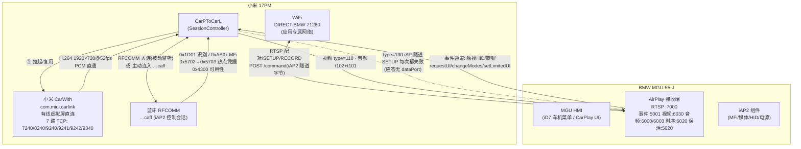
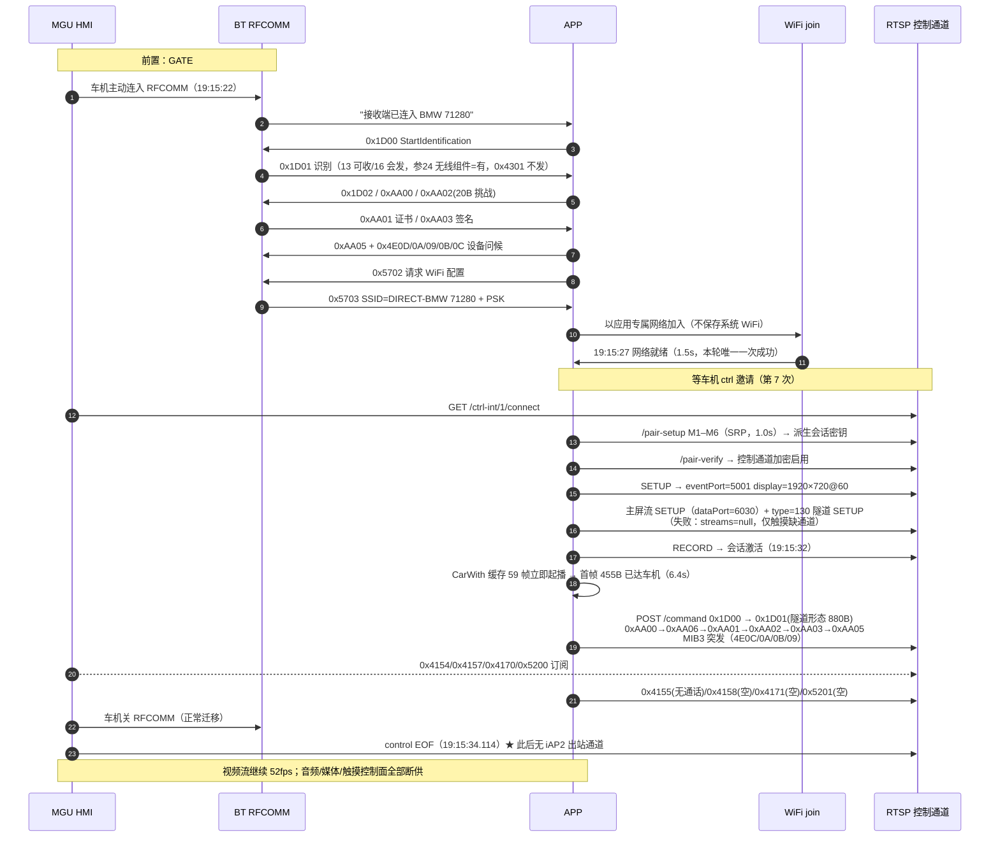
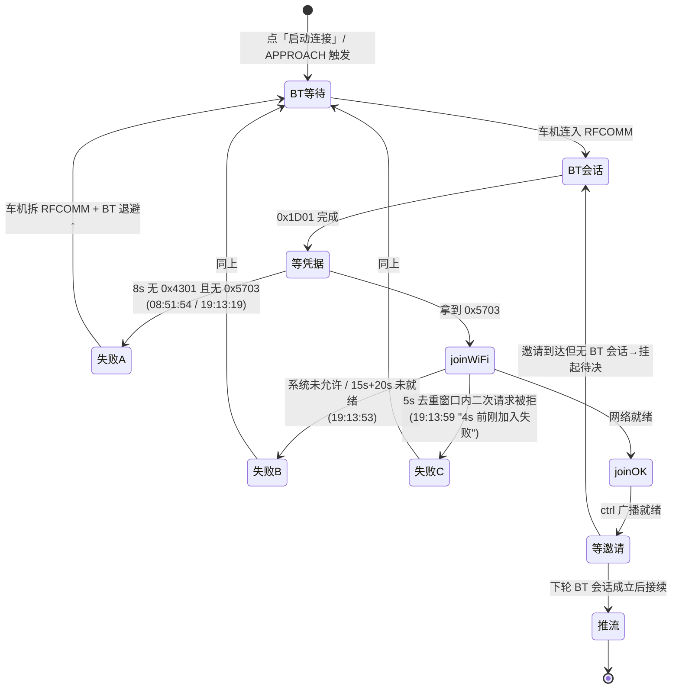
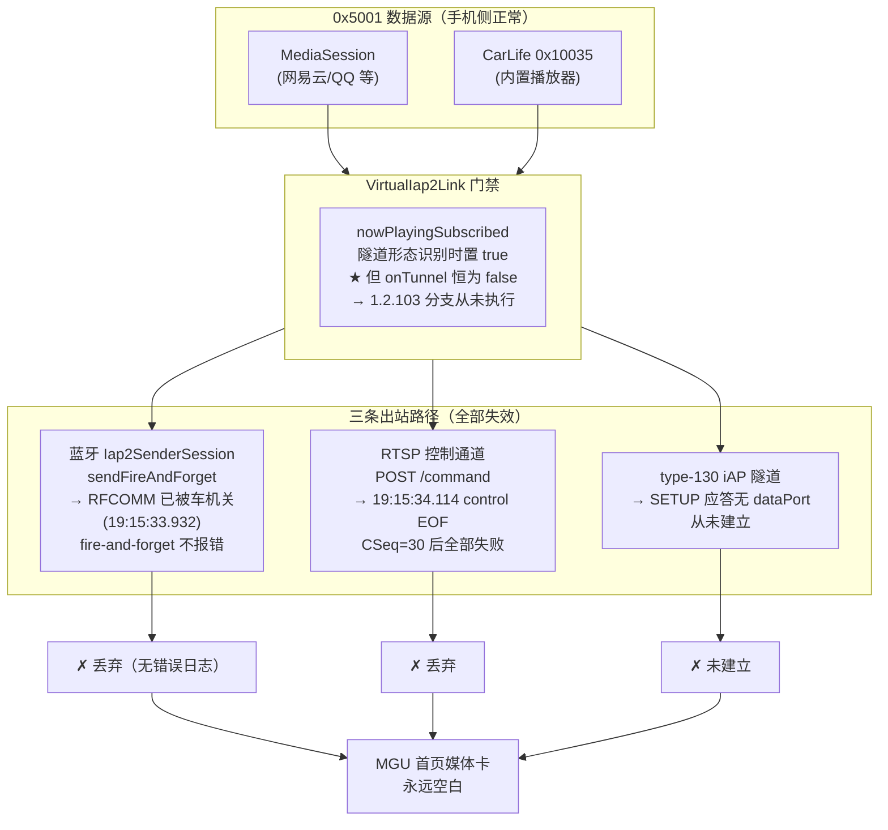
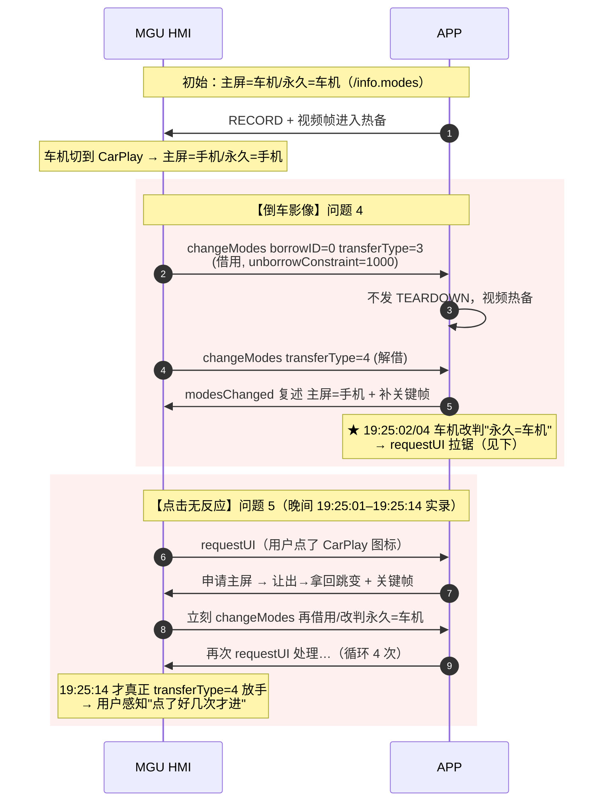

# BMW MGU-55-J × 小米 17PM 全链路流程梳理（2026-11-23）

依据：三份实车日志（085705 / 191538 / 192522，均为 1.2.103-debug）+ 仓库代码。
范围：**只覆盖本机适配**——Xiaomi 17PM（HyperOS，非 root）+ BMW MGU-55-J + CarWith 有线虚拟屏画面源，通用分支（奥迪/本田/大众等）不在本档讨论。

日志证据统一标注为 `hh:mm:ss`（晚间日志为主，成功会话 = GATE 会话 #6，19:15:25→19:15:33）。

---

## 1. 组件与通道总览（流程图）



三条通道分工与**生命周期终点**（边界核心）：

| 通道 | 职责 | 何时关闭（日志证据） |
|---|---|---|
| 蓝牙 RFCOMM | 识别/MFi/WiFi 凭据协商 | **车机主动关**（19:15:33.932 `read return: -1`），视为正常迁移 |
| RTSP 控制通道 | POST /command（iAP2 出站字节）+ 流 SETUP | **车机在订阅应答后 ~0.2s 关**（19:15:34.114 `control EOF`，CSeq=30） |
| type-130 iAP 隧道 | 设计上承载双向 iAP2 | **从未建立**：`SETUP 应答无 dataPort（streams=null）`，全天 7 次 |

> **关键结论**：推流成功后，手机侧没有任何活着的 iAP2 出站通道。`隧道 rx/tx` 日志前缀是 `VirtualIap2Link` 的硬编码文案，实际形态是 **MIB3/控制通道**（0x1d01 从事件通道 `iAPSendMessage` 进来），不是真隧道。

### 1.1 复审修正（2026-11-23 二次核对，推翻首版三条结论）

首版把问题归为「控制通道被车机关」。逐行复核后，**真实机制更靠前一步**：

| 会话 | 车机在事件通道主动发 marker？ | 链路走到 NORMAL？ | 0x1D01 识别？ |
|---|---|---|---|
| #6 (19:15:31) | **是**（19:15:32.168） | ✓ | ✓（19:15:32.496） |
| #7 (19:15:45) | 否 —— 我们发 detect，车机不理 | ✗ 停在 NEGOTIATING | ✗ |
| #8 (19:24:46) | **是**（19:24:46.816） | ✓ | ✓（19:24:46.925） |
| #9 (19:24:54) | 否 | ✗ 停在 NEGOTIATING | ✗ |

**铁律：MGU 只在它自己主动于事件通道发 `iAPSendMessage` marker 的会话里建立 iAP2 链路；
我们经 `POST /command` 主动发的 MIB3 detect，它一律不回 SYN。**

由此修正两处：

1. **问题 2 的根因不是「控制通道被关」，而是「iAP2 会话压根没建起来」**。会话 #7 里
   `mib3Identified` 恒为 false → `VirtualIap2Link.pushNowPlaying` 直接 return →
   0x5001 只能落到蓝牙链路。而车机已在 19:15:33.932 关掉 RFCOMM 并把 iAP2 迁到 WiFi，
   **蓝牙侧发出的 0x5001 它不再消费**——`fire-and-forget` 又不报错，日志一片干净。
2. **「控制通道保活」不是第一优先级**：会话 #6 的 control EOF 发生在识别完成后 2 秒，
   那是车机侧行为（`appStates=2:0`，CarPlay app 未激活），不是我们消息断供导致的。

### 1.2 复审新增的头号根因：0x1D01 清单抖动 → 代际误判 → 整轮报废

同一台 MGU-55-J，`车机可收清单` 在 12/13 项之间抖动，**仅差 `0x5702` 一项**：

```
19:12:36.310  可收清单(13)=… 0xea01 0x5702   ← LEGACY，成功拿到 0x5703
19:13:11.178  可收清单(12)=… 0xea01          ← 少了 0x5702
19:13:28.955  可收清单(13)=… 0xea01 0x5702   ← LEGACY，又成功
```

12 项那一轮连带三个后果（19:13:11 → 19:13:19 整轮报废）：

1. `清单完整（28 项）仍无 0x5703/0x5702` → `ReceiverProfile` 判 `wifiGen=NEW`；
2. NEW 分支**不发 0x5702**（日志原文 `本轮不发 0x5702`）→ 车机永远不会回 0x5703；
3. NEW 同时开**严格模式**，把 0x5702 在发送前再裁一次（双保险地再堵一遍）。

**这就是「连接不顺畅」的头号原因**，而不是 BT/WiFi 退避本身：五轮失败里有至少一轮是
被自己的代际判定堵死的。修复见 §9-F1（车机记忆优先）。

---

---

## 2. 连接建立时序（成功路径，对应 GATE 会话 #6）



---

## 3. 失败重试循环（问题 1 的结构）



晚间实测节奏（GATE #1→#6）：

| 会话 | 开始 | 结束 | 耗时 | 死因 |
|---|---|---|---|---|
| #1 | 19:12:38 | 19:13:01 | 22s | 8s 无 0x4301/0x5703 |
| #2 | 19:13:31 | 19:13:54 | 23s | 系统未允许加入热点 |
| #3 | 19:13:59 | 19:14:22 | 23s | 同上 |
| #4 | 19:14:28 | 19:14:51 | 22s | 同上 |
| #5 | 19:14:57 | 19:15:19 | 22s | 同上 |
| #6 | 19:15:25 | **推流成功** | 6.4s | — |

两次失败间的乘数效应：BT 退避 16→24→30→45→60s **叠加** WiFi join 15–35s，导致从第一次尝试到出帧约 4 分钟。

**边界与当前处理**：

| 边界 | 当前处理 | 问题 |
|---|---|---|
| 8s 无 0x4301 | 直接失败让车机重建链 | 车机**从不声明**会发 0x4301（0x1D01 可选消息声明明确"不发"），这个窗口对该车是纯浪费；0x5703 才是真凭据 |
| WiFi join 被系统拒 | 等 15s+宽限 20s | 车机热点 channel=157，信号/权限抖动时 35s 才判死 |
| 5s 去重窗口 | 二次请求直接拒绝 | 上轮失败后立刻再试会被去重吞掉（19:13:59） |
| BT 退避递增 | 连续失败加长间隔 | 拿到新 0x5703 不重置退避 |
| 邀请早于会话 | 挂起待决（cache_miss 自愈） | 正常，但多等一轮 BT |

---

## 4. 会话内 iAP2 / 媒体控制流（问题 2 的根因图）



日志实锤：
- 0x5001 实际发送 4 次（19:16:00 / 19:19:46 / 19:22:53 / 19:24:15），全部带 `LINK tx / RAW tx` 前缀 = **蓝牙链路格式**；此时 RFCOMM 已关。
- `iap2 tx=0x5001（发后不管）`——fire-and-forget 设计（奥迪"不 ACK 也不拆链"经验）在本场景把失败完全静音。
- 车机在订阅应答（0x4155/0x4158/0x4171/0x5201）发完后 ~0.2s 关控制通道：`POST 失败 - 控制通道已关闭（CSeq=30 POST /command）`。

**已修正的因果（复审 §1.1）**：会话 #6 的 control EOF 不是「消息断供」导致的保活失败，而是
车机侧行为（`appStates=2:0`，CarPlay app 未激活）。真正让后续所有推送失效的是**会话 #7 的 iAP2
链路压根没建立**——车机没主动发 marker，我们的 detect 它不回 SYN，`mib3Identified` 恒 false。

因此「控制通道保活」不再是第一优先级实验。**新的第一优先级是 §9-F1**（代际误判堵死连接）
与「如何让车机主动发起 iAP2 会话」（待真 iPhone 对照抓包，见 §9 未决项）。

---

## 5. 主屏仲裁时序（问题 3/4/5 的根因图）

MGU 的主屏仲裁是**借用/解借**模型（resourceID=1，unborrowConstraint=1000），围绕它的三种事件：



三个具体缺陷：
1. **requestUI 的"先让出再拿回"**（`MODE: requestUI 且主屏在本机——已执行让出再拿回跳变`）在 MGU 上适得其反：让出动作被 HMI 读成"手机放弃"，随即改判永久=车机。晚间 19:25:04.032 拿回 → 04.068 车机秒收回，就是这条拉锯。
2. **无"自动进首页"信号**：全程 `appStates=2:0`（CarPlay appState 未激活）。真 iPhone 会在会话激活时给车机一个我们没发的信号（候选：0x4E0D WirelessCarPlayUpdate、requestUI 主动发起、或 /play 态唤醒），导致问题 3。
3. **暂停冻结联动**：MediaSession 暂停 → 冻结 0x5001 + 引擎静音 PCM，车机若在此时退出 UI，恢复后没有任何"重新唤醒 UI"的路径。

---

## 6. 边界情况总表（当前处理 × 目标处理）

| # | 边界 | 触发条件 | 当前处理 | 目标（MGU 专属简化） |
|---|---|---|---|---|
| E1 | 8s 无 0x4301 | 车机从不声明发它 | 失败整轮 | **删窗口**：以 0x5703 为唯一凭据判据 |
| E2 | WiFi join 被拒 | 系统未允许/超时 | 15+20s 判死 | 失败即重试 specifier（≤5s），并把 BT 退避重置 |
| E3 | join 5s 去重 | 上轮失败后立即再试 | 直接拒绝 | 失败路径豁免去重 |
| E4 | BT 退避递增 | 连续失败 16→60s | 保持 | 拿到 0x5703 即重置为 8s |
| E5 | RFCOMM 被车机关 | 正常迁移 | 判"正常交接"，继续 | ✓ 已正确 |
| E6 | 控制通道 EOF | 订阅应答后车机关 | 转被动等待 | **保活**：RECORD 后周期 POST /command（0x4300 fire-and-forget） |
| E7 | type-130 隧道无 dataPort | 每次 SETUP | 记日志继续 | 固定行为，日志降级为一次说明 |
| E8 | requestUI 拉锯 | 倒车/退出后点图标 | 让出→拿回→被收回 | **去掉让出跳变**：直接复述 modes + 关键帧，不主动让出 |
| E9 | 永久=车机改判 | HMI 抢主屏 | 等下次 requestUI | requestUI 到达时若被借用→立即 unborrow 应答（transferType=4 复述） |
| E10 | 无自动进首页信号 | 会话激活 | 无 | 抓真 iPhone 对照后补发（0x4E0D 或主动 requestUI） |
| E11 | 暂停冻结 | 播放暂停 | 冻结 0x5001 | ✓ 保留；但退出 UI 后需有唤醒路径（挂 E10） |
| E12 | fire-and-forget 静音失败 | 0x5001 发往死链 | 无感知 | 每条链路 push 前 `isAlive()` 检查，死了记一行 |
| E13 | WiFi 前置检查 | 未连任何 WiFi | PREFLIGHT 告警 | ✓ 已正确（1.2.102） |
| E14 | 编码器中途分辨率变更 | 1280 轮出现 | 引擎忽略 | ✓ 画布按车分键缓存（1.2.102）规避 |
| E15 | 触摸无隧道 | E7 连带 | 触摸走事件通道 hidSendReport | ✓ 实际可用（uuid=1 触摸、uuid=0 旋钮均正常到达） |

---

## 7. 你的车型专属简化清单（代码可以删/收敛的部分）

1. **删 0x4301 等待窗口**（E1）：`Iap2SenderSession` 里"车机未声明会发 0x4301 但声明了参24"的 8s 分支，对本车永远失败。
2. **删隧道形态分支**（E7 + 问题 2 门禁）：`VirtualIap2Link` 的 `onTunnel/tunnelIdentified/tunnelCsmStarted/tunnelEchoDelivered` 整族状态在本车恒为 false，1.2.103 的"隧道识别完成即视为订阅"分支永不执行。保留 MIB3/事件形态即可，日志文案把"隧道"改回"MIB3/控制通道"。
3. **删非小米路由**（按之前约定）：`resolvePreferred` 的 AUTO→CarWith 路由对非小米设备的分支保留判定但不再维护。
4. **requestUI 处理收敛**（E8/E9）：去掉"先让出再拿回"，改为"借用中 → 复述 unborrow（transferType=4）+ 关键帧"。
5. **控制通道保活**（E6）：新增 30s 周期 0x4300 fire-and-forget，观察控制通道 EOF 是否消失——这是解锁问题 2/3/5 的前置实验。

---

## 8. 修复优先级建议

| 优先级 | 项 | 对应问题 | 成本 |
|---|---|---|---|
| P0 | **F1 车机记忆优先判代际**（已修 1.2.104） | 1（头号根因） | 小 |
| P0 | E1 8s 窗口（F1 修好后该类轮次不再进入） | 1 | 小 |
| P1 | E2/E3/E4 WiFi+退避联动 | 1 | 中 |
| P1 | E8/E9 requestUI 收敛 | 4/5 | 中 |
| P1 | **F4 0x5001 静默丢弃可见化**（已修 1.2.104） | 2（可观测性） | 小 |
| P2 | E10 自动进首页信号 / 车机主动发起 iAP2 的条件 | 3 + 2 | 需真 iPhone 对照抓包 |
| P2 | E6 控制通道保活实验（降级：非根因） | — | 小 |

## 9. 1.2.104 已实施修复

### F1 车机记忆优先判代际（对应 §1.2，问题 1 头号根因）

新增 `iap2/WifiGenMemory.kt`：按车机身份（`name model manufacturer` 归一化，与
`MfiLengthMemory` 同一套键规则）持久记住「这台车机回过 0x5703」。

接线三处：

1. `ReceiverProfile.Signals` 新增 `knownLegacyWifi`，在 `classify` 的 wifiGen 判定里**排第一位**——
   记忆命中即 LEGACY，理由是「清单只能证明有，不能证明没有」。
2. `Iap2SenderSession` 构造 Signals 时读记忆（素材与 `identityKeyOf` 逐字段一致）。
3. 收到 0x5703 的分支里 `WifiGenMemory.markLegacy(...)`，首次写入时打一行
   `iap2 车机记忆：该接收端走过旧代 WiFi 协议（0x5703）——此后清单漏项不改判`。

连带效果：判 LEGACY 后 `setStrictDeclaredOnly(false)` 不再开严格模式，0x5702 不会被裁。

单测：`ReceiverProfileTest.knownLegacyWifiOverridesFullListsWithoutOldProtocol`
（用与 NEW 判定用例**完全相同**的清单形态，只加 `knownLegacyWifi=true`，断言翻成 LEGACY）。

### F4 0x5001 静默丢弃可见化（对应问题 2 排障）

`VirtualIap2Link.pushNowPlaying` 在会话未识别时原本静默 return。现在留一行 30 秒限流的归因：

```
IAPLINK: 0x5001 未发出——iAP2 控制面带内会话尚未识别
（mib3Identified=false tunnelIdentified=false link=NEGOTIATING）——车机首页媒体卡此时收不到歌名
```

下次日志里能一眼区分「发了但车机不显示」与「压根没发」。

### F5 日志形态文案（防再次误判）

`VirtualIap2Link` 新增 `formLabel()`：真隧道（type-130 建成）打「隧道」，MIB3/控制通道形态打
「控制通道」。旧实现两种形态都硬编码「隧道」，正是首版分析被带偏的直接原因。
